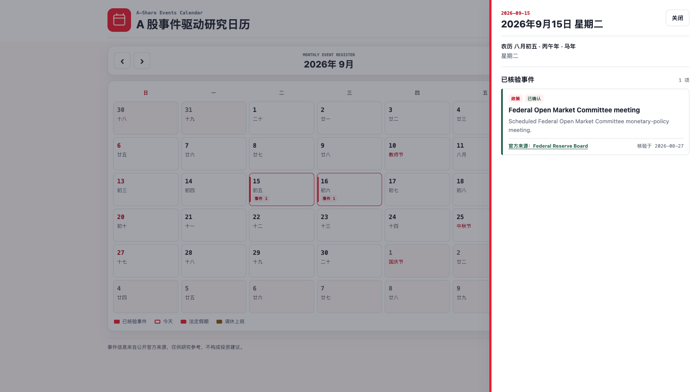

# A 股事件驱动研究日历

一个开源日历，用于查阅与 A 股研究相关、已由官方公布的政策、宏观、市场、行业、公司及产品事件。

[English](README.md) | [简体中文](README.zh-CN.md)

[规范演示地址](https://siliang42.github.io/a-share-events-calendar/) | [代码仓库](https://github.com/siliang42/a-share-events-calendar)

[](LICENSE)
[](https://github.com/siliang42/a-share-events-calendar/actions/workflows/pages.yml)
[](https://github.com/siliang42/a-share-events-calendar/actions/workflows/validate.yml)

该规范演示地址是发布工作流的部署目标。在工作流完成前，本文不宣称部署已经成功。

## 预览



该 1600 x 900 核验预览图展示了可交互检查的 2026 年 9 月日历及其官方来源事件详情。

## 适用人群

- 跟踪确定日期市场催化因素的权益和行业研究人员。
- 维护有来源依据的中国股票市场日历的分析师。
- 需要小型、可审计金融日历数据模型的开发者。
- 将日期证据纳入事件驱动研究的团队。

## 来源与覆盖政策

每项事件都必须由官方机构公布，或由可通过 HTTPS 访问的一手来源记录。每条记录都要注明来源名称、来源链接和最近核验日期。二手报道可以帮助定位公告，但不足以作为收录证据。传闻、推断日期、预测和无来源估计不予收录。

数据结构支持以下分类和状态：

| 维度 | 支持值 |
| --- | --- |
| 分类 | `macro`、`policy`、`market`、`industry`、`company`、`product` |
| 状态 | `confirmed`、`postponed`、`cancelled` |

当前运行时覆盖范围刻意保持较小：`js/data.js` 仅包含 3 条已确认的 2026 年联邦公开市场委员会会议记录，均于 2026-08-27 根据美国联邦储备委员会页面核验。支持的分类表示数据契约，而不表示当前覆盖广度。

## 功能

| 能力 | 当前行为 |
| --- | --- |
| 月历 | 显示响应式六周视图，包含农历、节日、事件标记和可选节假日元数据。 |
| 日期详情 | 为选中日期打开支持键盘操作的详情对话框。 |
| 事件依据 | 显示分类、状态、事实描述、官方来源和核验日期。 |
| 日期区间 | 从 `startDate` 到 `endDate` 的每一天都显示跨日事件。 |
| 导航 | 提供上月、下月和回到今天控件。 |
| 发现元数据 | 提供规范链接、Open Graph、schema.org JSON-LD、站点地图、robots 和 `llms.txt` 元数据。 |
| 运行时体积 | 使用浏览器原生 HTML、CSS 和 JavaScript，无生产依赖或构建步骤。 |

## 快速开始

克隆仓库，并在现代浏览器中打开 `index.html`：

```bash
git clone https://github.com/siliang42/a-share-events-calendar.git
cd a-share-events-calendar
open index.html
```

在没有 macOS `open` 命令的平台上，请通过文件浏览器打开 `index.html`。运行应用无需安装软件包；执行验证需要 Node.js 20 或更高版本。

## 事件数据结构

事件保存在 `js/data.js` 的 `EVENTS` 数组中，并按 `startDate` 排序：

```js
{
    id: "fomc-2026-09",
    title: "Federal Open Market Committee meeting",
    startDate: "2026-09-15",
    endDate: "2026-09-16",
    category: "policy",
    description: "Scheduled Federal Open Market Committee monetary-policy meeting.",
    status: "confirmed",
    sourceName: "Federal Reserve Board",
    sourceUrl: "https://www.federalreserve.gov/monetarypolicy/fomccalendars.htm",
    verifiedAt: "2026-08-27"
}
```

以上 10 个字段都是必填的非空字符串。日期采用 `YYYY-MM-DD`；ID 和规范化事件签名必须唯一；日期区间不能倒序；来源 URL 必须使用 HTTPS 且不得嵌入凭据；`verifiedAt` 不能是未来日期。修改记录前请阅读 [CONTRIBUTING.md](CONTRIBUTING.md)。

## 验证

提交变更前运行完整本地契约：

```bash
npm run check
```

该命令会运行 Node 测试套件，并验证事件字段、唯一 ID 和事实签名、日期、分类、不含凭据的 HTTPS 来源、核验日期和时间排序。也可以单独运行：

```bash
npm test
npm run validate:data
```

真实浏览器回归是独立的贡献者检查。安装精确的开发依赖锁定版本和 Chromium 后运行：

```bash
npm ci
npx playwright install chromium
npm run test:browser
```

该检查会在桌面和窄屏移动端视口中运行 Chromium，覆盖日历导航、响应式溢出、详情对话框焦点、安全来源链接和运行时事件元数据。

## 架构

```text
index.html
  -> css/app.css               视觉系统和响应式布局
  -> js/lunar.js               基于 Intl 的农历注释适配器
  -> js/data.js                EVENTS 和可选 HOLIDAYS 记录
  -> js/event-utils.js         纯查找、URL、标签和 JSON-LD 辅助函数
  -> js/app.js                 渲染、导航和对话框行为

scripts/validate-data.js       命令行数据验证
browser/calendar-regression.mjs 真实 Chromium 回归检查
test/                          Node 内置测试套件
```

浏览器将 `EVENTS` 作为全局变量使用，CommonJS 导出则让 Node 能检查同一批记录和辅助函数。`js/lunar.js` 通过浏览器标准 `Intl.DateTimeFormat` 中国农历日历生成可选的农历月、日、干支年、生肖和星期注释。外部事件值通过 DOM 文本 API 渲染；来源链接只有通过 HTTPS URL 验证后才会使用。

## 贡献

请先阅读 [CONTRIBUTING.md](CONTRIBUTING.md)，再按需使用结构化的事件或更正 Issue 表单。典型数据贡献流程如下：

1. 在官方或一手 HTTPS 页面确认公告。
2. 在 `js/data.js` 中新增或更正记录，不改变事实含义。
3. 运行 `npm run check`。
4. 创建范围集中的拉取请求，并完成来源政策检查表。

社区参与遵循[行为准则](CODE_OF_CONDUCT.md)。安全漏洞请按照[安全政策](SECURITY.md)私下报告。

## 路线图

- 仅通过经过评审且有一手来源支持的记录扩展覆盖范围。
- 在保留人工评审的前提下增加来源复核提醒和可用性检查。
- 扩大无障碍和跨浏览器回归测试覆盖范围。
- 仅在来源和验证契约仍可审计的前提下改进筛选和导出。

路线图是意向，不是承诺，也不代表当前已经具备这些功能。

## 局限

- 当前数据集只有 3 条已核验的 2026 年 FOMC 记录，并非完整市场日程。
- 官方公告可能在 `verifiedAt` 之后变化；最新信息以链接中的来源为准。
- 渲染器支持节假日，但 `HOLIDAYS` 当前为空。
- 农历注释依赖运行环境对 `Intl` 中国农历日历的支持。该 API 不可用或无法解析日期时，界面会回退到公历信息；本项目有意不提供节气及干支月、日。
- 本项目不提供投资建议、价格预测、证券排名、提醒或交易建议。

## 项目文档

- [贡献指南](CONTRIBUTING.md)
- [行为准则](CODE_OF_CONDUCT.md)
- [安全政策](SECURITY.md)
- [变更日志](CHANGELOG.md)
- [引用元数据](CITATION.cff)
- [MIT 许可证](LICENSE)

## 引用

引用本软件时请使用 [CITATION.cff](CITATION.cff) 中的元数据。正文中请使用英文名称 *A-Share Events Calendar*，并注明所用版本和代码仓库 URL。

## 许可证

本项目采用 [MIT 许可证](LICENSE)。
